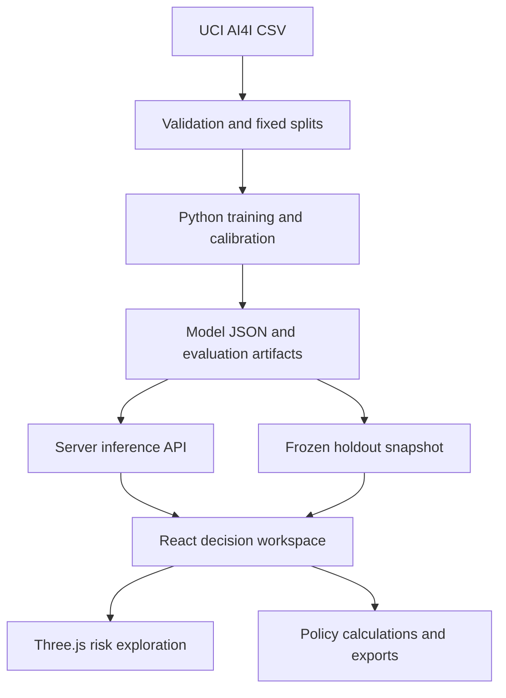

# Axiom — Technical Requirements Document

Version 1.0 · 8 October 2026

## 1. Implemented architecture



This is a full-stack analytical application: a React/TypeScript client, validated server APIs, exported model inference, and an offline reproducible Python training pipeline. The hosting runtime is a Cloudflare-compatible Worker built with Vinext/Vite. The repository preserves the Sites starter’s scripts and deployment integration.

No database is needed for a frozen benchmark with session-only policies. The versioned CSV, split IDs and generated JSON are the source of truth. User interactions never rewrite training artifacts. A production event store and monitoring service are explicitly future work.

## 2. Stack

| Layer | Implemented choice |
|---|---|
| UI | React 19, TypeScript, semantic HTML, CSS/Tailwind tokens |
| Primitives | Installed Shadcn/Radix tabs, select, slider, table and sheet |
| 3D | Three.js and OrbitControls, loaded on demand |
| Server | Vinext route handlers, Worker-compatible ESM |
| Contracts | Zod input validation |
| ML | Python 3.12, scikit-learn random forest/logistic regression/isotonic calibration |
| Reproducibility | Source CSV, SHA-256, fixed split manifest, seed 42, pinned Python requirements |
| Testing | Python/JS inference parity, split disjointness, schema rejection, warnings, policy parity, typecheck and build |
| Hosting | Sites source repository and deployment archive |
| Persistence | Committed benchmark files; current UI state only |

Exact application dependency versions are in package.json and pnpm-lock.yaml. The training environment is recorded in artifacts/metrics.json and ml/requirements.txt.

## 3. Dataset contract and lineage

Source: AI4I 2020 Predictive Maintenance Dataset, UCI, DOI https://doi.org/10.24432/C5HS5C. Dataset license: CC BY 4.0. Its 10,000 rows are synthetic, not measured industrial telemetry. The raw CSV is stored unchanged at data/raw/ai4i2020.csv.

| Column | Role | Contract |
|---|---|---|
| UDI | Observation key only | Unique integer; excluded from model |
| Product ID | Reference only | Excluded from model; no stable asset identity assumed |
| Type | Predictor | L, M or H; M/H indicator columns |
| Air temperature [K] | Predictor | Finite numeric, original Kelvin |
| Process temperature [K] | Predictor | Finite numeric, original Kelvin |
| Rotational speed [rpm] | Predictor | Finite numeric, original rpm |
| Torque [Nm] | Predictor | Finite numeric, original Nm |
| Tool wear [min] | Predictor | Finite numeric, original min |
| Machine failure | Target | Binary 0/1 |
| TWF/HDF/PWF/OSF/RNF | Failure-mode target metadata | Never predictors; excluded to prevent label leakage |

Training validates row count, missingness, unique IDs and allowed quality types. Split IDs are persisted. A stronger incoming-data contract and continuous anomaly monitoring belong to a real ingestion service, not this frozen demo.

## 4. Features

Model input order is fixed and exported with the artifact:

1. Air temperature
2. Process temperature
3. Rotational speed
4. Torque
5. Tool wear
6. Type M indicator
7. Type H indicator
8. Temperature delta = process − air
9. Mechanical power = speed × torque × 2π / 60
10. Wear × torque

Derived features use only predictors available at the operating state. No labels or identifiers enter engineering. Mechanical relationships improve sample efficiency but are correlated with the original inputs, so importance is not interpreted causally.

## 5. Evaluation design

- Stratified random split, seed 42: 6,000 train / 2,000 calibration / 2,000 test.
- StandardScaler is fit within the training-only logistic pipeline.
- Random forest: 120 trees, depth 9, leaf minimum 3, max_features 0.8, balanced_subsample.
- Logistic baseline: balanced class weights, max_iter 2,000.
- Separate isotonic calibrator for each model, fit on the calibration split only.
- Threshold selected on calibration probabilities by minimizing `inspections × 150 + misses × 12000` across a fixed candidate grid plus calibration probabilities.
- Test set is untouched by fitting and threshold selection. Interactive test policy changes are exploratory analysis.
- AP is the primary ranking metric because failures are rare; AUROC and Brier complement it.
- 400 fixed-seed holdout bootstrap resamples yield an AP 95% interval. This interval does not quantify transfer to industrial data.
- Permutation importance uses the calibration set, five repeats, AP scoring, on the underlying forest rather than the isotonic layer.
- PSI compares train and test using fixed train-quantile bins with a small-count floor.
- Product-quality slices report sample/failure counts, AP and default-threshold recall.

Calibration fitting and policy choice share the calibration set, which can overfit policy choice. Hyperparameters are selected engineering defaults rather than the result of a documented exhaustive search. A production study requires nested validation or a separate policy split.

## 6. Row-order stress evaluation

A separate forest uses the same fixed settings on rows 1–6,000, calibration on 6,001–8,000, and test on 8,001–10,000. This is a row-order sensitivity proxy, not a true time validation: no timestamps, forecast lead time or stable machine grouping are established.

The deployed artifact remains the stratified-split model. Both evaluations are reported, including the performance drop.

## 7. Portable model artifact

artifacts/model.json contains version, seed, feature names, training medians/ranges, a list of trees (child indexes, feature indexes, thresholds, leaf probabilities), isotonic breakpoints, and recommended threshold.

Server prediction:

1. Validate and engineer features.
2. Cast features to float32 to match scikit-learn forest input precision.
3. Traverse each tree until its leaf.
4. Average positive-class probabilities across trees.
5. Linearly interpolate the isotonic breakpoint map with clipped endpoints.
6. Return calibrated probability, sensitivity and range warnings.

The model is loaded server-side once per module. It is not included in the client component import graph. Immutable model data is shared safely; request-specific state is local. The exported model is roughly 0.36 MB, suitable for this demonstration runtime; real model sizes must be budgeted explicitly.

## 8. Explanation contract

For each original numeric sensor, replace that one sensor with its training median, recompute all derived features, score again, and return:

`delta = original_probability − median_replacement_probability`

These are nonadditive sensitivity measures, not SHAP values, additive attributions or causal effects. Replacing correlated sensors independently can create implausible combinations; explanations are interpretive diagnostics only. Type is not included in the numeric median-replacement list.

## 9. HTTP APIs

### POST /api/predict

Content-Type: application/json. Body example:

```json
{"type":"L","air":300,"process":310,"speed":1500,"torque":40,"wear":100}
```

Strict schema rejects additional fields. Supported hard bounds: air 250–400 K, process 250–450 K, speed 100–6,000 rpm, torque 1–150 Nm, wear 0–500 min. These bounds prevent extreme resource/malformed inputs; they are broader than the observed training support. Training-range warnings do not make unsupported predictions reliable.

Returns 200 with version, risk, sensitivity, warnings and method. Returns 400 for invalid JSON/schema; 413 for oversized bodies. Streaming request reads are capped at 4,096 bytes and large declared content lengths are rejected before parsing. No user input is interpolated into code or SQL. Probability responses use Cache-Control: no-store.

### GET /api/health

Returns status, model version, dataset identity and demo mode. It establishes route availability, not statistical validity or machine safety.

### GET /benchmark.json

Versioned static JSON containing the frozen test observations and evaluation metrics. Public benchmark content contains no customer data. Observation risks are rounded to six decimals for display/export.

## 10. Client behavior

- Fetch the benchmark once per mounted workspace.
- Derived scope, queue and confusion counts come from the same scoped observations.
- Threshold/cost inputs change client policy results immediately.
- Observation selection requests a server explanation; previous requests are aborted.
- Scenarios require an explicit evaluation; changing inputs clears the stale result.
- CSV/JSON exports use browser-generated Blob downloads.
- Main view navigation uses accessible tabs. Details use an accessible modal sheet.
- 3D is dynamically loaded; geometry is one point cloud, limited pixel ratio, render-on-change and ResizeObserver.
- GPU resources, controls, listeners and observers are cleaned up on replacement/unmount.

## 11. Optional WebMCP

Where the browser exposes document.modelContext, register read_inspection_policy and configure_inspection_threshold. They use the same UI state and validate bounds. Unsupported browsers continue normally. No supported browser validation context was available in this environment, so native WebMCP execution validation is not claimed.

## 12. Security and deployment boundary

No API keys, user credentials or database secrets are required. Source credentials are supplied to the publishing helper through stdin and never persisted. Hosting access is managed by Sites; the initial deployment is private to its owner.

This demonstration has input limits but no application-level rate limiter, customer authentication, audit store or SLO enforcement. Before a public/high-volume rollout, add abuse controls, load testing, security headers policy, ownership decisions for data access, and request telemetry with privacy safeguards.

## 13. Tests and release checks

scripts/verify-science.mjs verifies:

- Thirty full-precision Python parity fixtures.
- All 2,000 displayed holdout scores agree to rounding tolerance.
- 10,000 split indexes are disjoint and complete.
- Expected holdout count and failure count.
- Valid observations satisfy the sensor contract.
- Six invalid input cases are rejected.
- Out-of-training-range warnings and finite sensitivities.
- Default confusion counts agree with frozen evaluation artifacts.

Also run TypeScript typecheck, framework production build, and HTTP health/prediction smoke checks. Browser visual and native WebMCP QA are unavailable because the required browser-control skill is not provided; responsive and interaction confidence relies on implementation inspection, compiled output and API checks until a browser review occurs.

## 14. Deployment and rollback

Sites builds Worker ESM with callable fetch, packages the exact committed source build, uploads the archive, saves the source version, deploys and verifies terminal status. Preserve a prior saved version for rollback; v1 is the first release.

A GitHub mirror is a separate source publication step. The connected GitHub app has existing-repository write actions but no repository creation action. Creating a dedicated repository requires browser permission or a user-provided writable repository. Do not overwrite unrelated repositories to satisfy this step.

## 15. Production evolution

Add dated asset observations, explicit forecast horizon, ingestion checks, event storage, temporal/grouped evaluation, nested model selection, calibration and policy validation separation, alert-capacity optimization, monitoring with delayed labels, incident response, and rollback. These are documented next steps, not implemented features.
